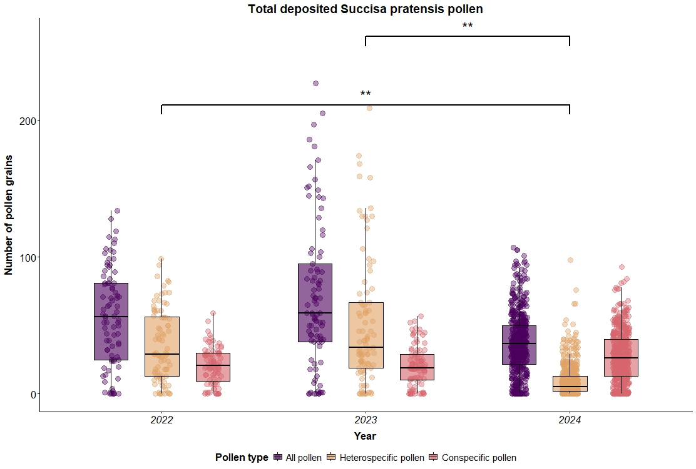
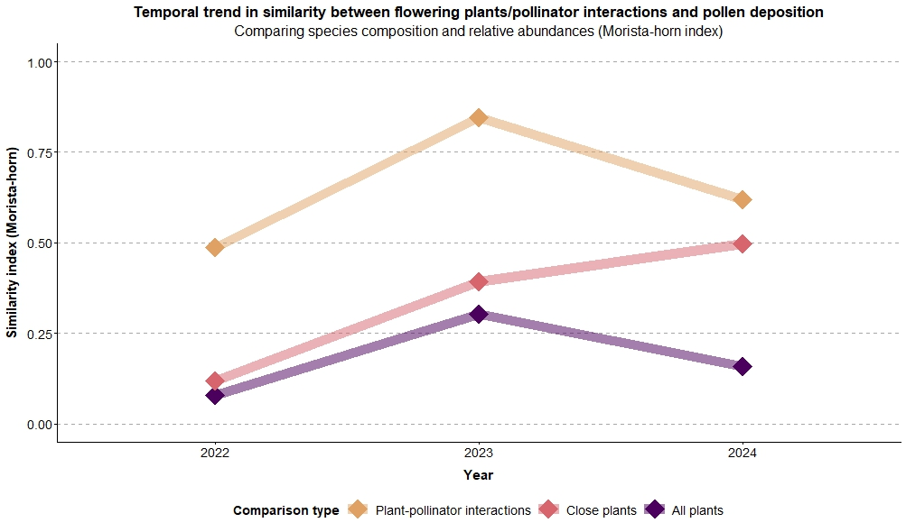
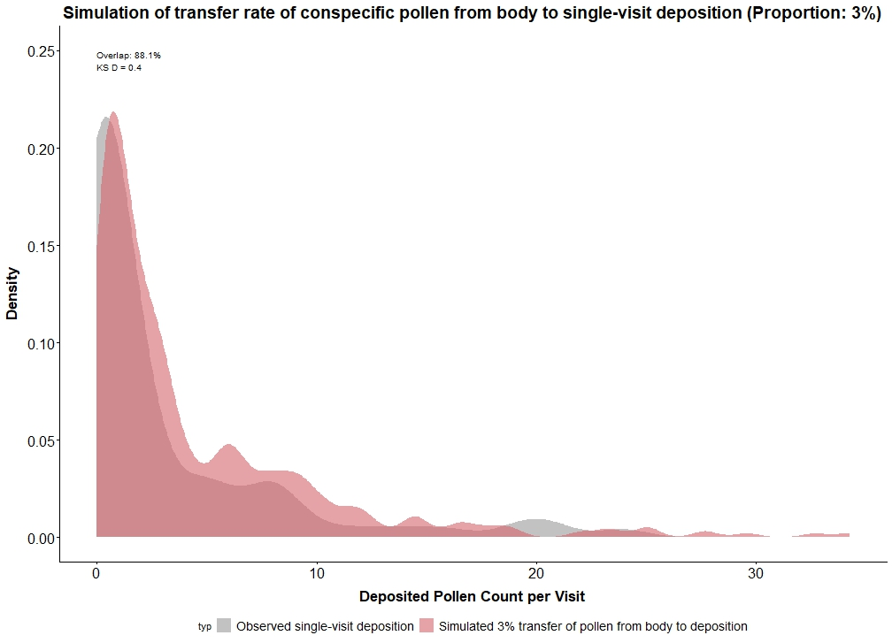
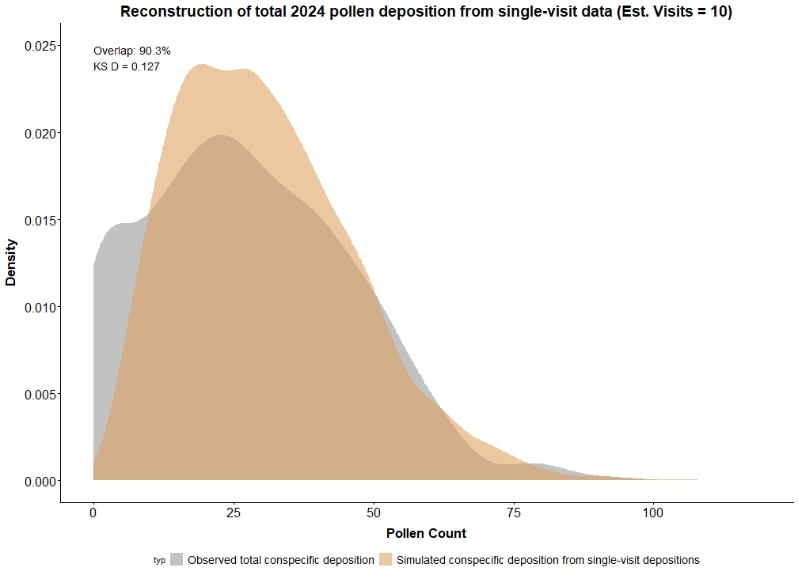

 Inter-annual comparison of conspecific, heterospecific and combined total depositions (2022-2024). Box colors differentiate the pollen categories: total pollen (purple), heterospecific pollen (light orange), and conspecific pollen (pink). Boxplots display the median (thick horizontal line) and interquartile range, with jittered dots representing individual field observations. Annotation highlights significant differences in conspecific pollen depositions (linear model, estimate = -6.8, p \< 0.02). Furthermore, heterospecific pollen depositions in 2024 were significantly lower than in 2022 and 2023 (pairwise wilcox test, p \< 0.001). Moreover, total pollen depositions in 2024 were significantly lower than in 2022 and 2023 (pairwise wilcox test, p \< 0.001). Data used were retrieved from total depositions.

 Inter-annual comparison of Morisita-Horn similarities (1 – dissimilarity) between total pollen deposition and three ecological baselines: plant-pollinator interactions, close plants (using plots only where S. pratensis is present), and the entire floral community (even accounting for plots without S. pratensis). Similarities of depositions to baselines are distinguished by different colors. Data used were retrieved from total depositions, flowering plant survey and plant-pollinator interaction sampling.

 Density distributions comparing observed single-visit conspecific pollen depositions on S. pratensis stigmas with a simulated deposition model. The grey area represents the empirical deposition data, while the pink area depicts the simulated distribution based on a pollen transfer rate of 3% from the pollinator's body. The high degree of distributional overlap (88.1%, Kolmogorov-Smirnov D = 0.400) supports this estimate as the most accurate representation of pollen transfer efficiency per visit. Data used were retrieved from single-visit depositions and sampling for pollen on pollinator bodies from 2024.

Cumulative single-visit depositions. The grey area represents the observed total pollen loads per stigma. The light orange area depicts the best-fit simulation, which estimates that the total observed loads are achieved after an average of 10 floral visits. The simulation achieved a high distributional overlap of 90.3% (Kolmogorov-Smirnov D = 0.127). Data used were retrieved from single-visit depositions and total depositions from 2024.
